# minichain

A compact blockchain written in Rust for learning purposes. It covers the full
loop of a UTXO-style chain - key pairs, signed transactions, a merkle-rooted
proof-of-work block, a persistent ledger, and a small peer-to-peer layer

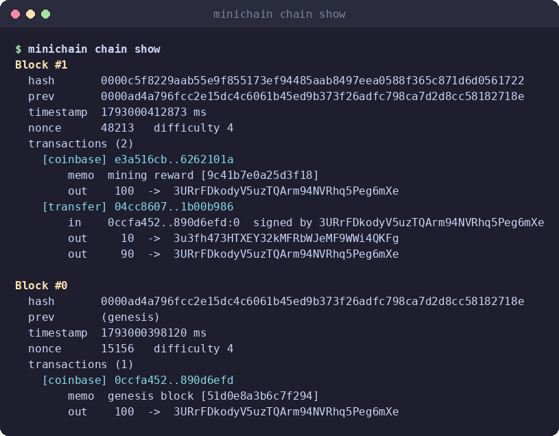

> **Status:** educational project. It is not hardened, must never hold anything of real value

## Features

| Area | What is implemented |
| --- | --- |
| Keys | ed25519 key pairs, Base58 addresses derived from `RIPEMD160(SHA256(pubkey))`, persistent keystore |
| Transactions | Inputs/outputs (UTXO model), change outputs, per-input signatures, coinbase rewards |
| Blocks | Merkle root over transaction ids, SHA-256 proof-of-work with a configurable difficulty |
| Ledger | Embedded `sled` database, chain head tracking, backwards iterator, block validation |
| UTXO index | Dedicated index for balances and coin selection, incremental updates, full rebuild |
| Networking | TCP node with handshake, peer exchange, inventory announcements, block sync, mempool relay, optional mining |
| CLI | Grouped sub-commands for wallets, chain, balances, payments, index and node control |

## Architecture

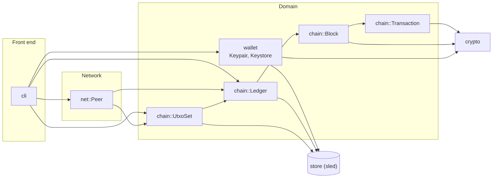

Everything persistent lives in one `sled` database made of four trees
(`blocks`, `meta`, `utxo`, `keys`), so a single process owns a single file lock
See [docs/architecture.md](docs/architecture.md) for module-by-module notes

## Quick start

Requirements: a recent stable Rust toolchain (edition 2021).

```bash
git clone https://github.com/walidwh21/MiniChain.git minichain
cd minichain
cargo build --release
cargo test
```

## Walkthrough

### 1. Create wallets and a chain

```bash
minichain wallet create          # run twice to get two addresses
minichain wallet list
minichain chain init <ADDRESS_A> # genesis block, 100 coins to ADDRESS_A
minichain balance <ADDRESS_A>
```

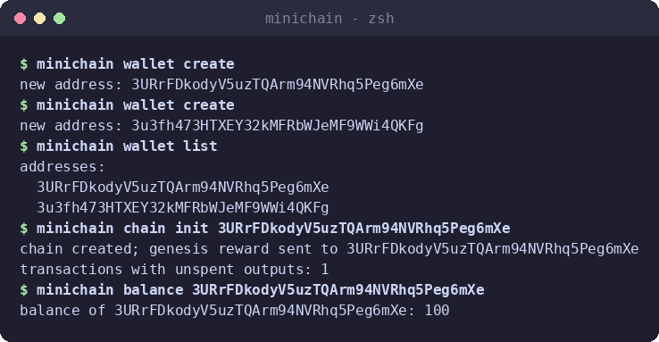

### 2. Send coins

`send` builds a signed transaction, adds a coinbase reward for the sender (who
acts as the local miner), mines a block and updates the UTXO index

```bash
minichain send <ADDRESS_A> <ADDRESS_B> 10
minichain balance <ADDRESS_A>    # 90 change + 100 reward = 190
minichain balance <ADDRESS_B>    # 10
```

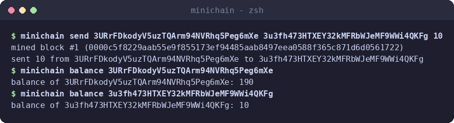

### 3. Inspect the chain

```bash
minichain chain show
```

The dump at the top of this page is that command: newest block first, each
transaction listed with its inputs, signers and outputs.

## How it works

### Block anatomy

A block hash commits to the previous block, to every transaction (through the
merkle root) and to the nonce that satisfies the proof-of-work target

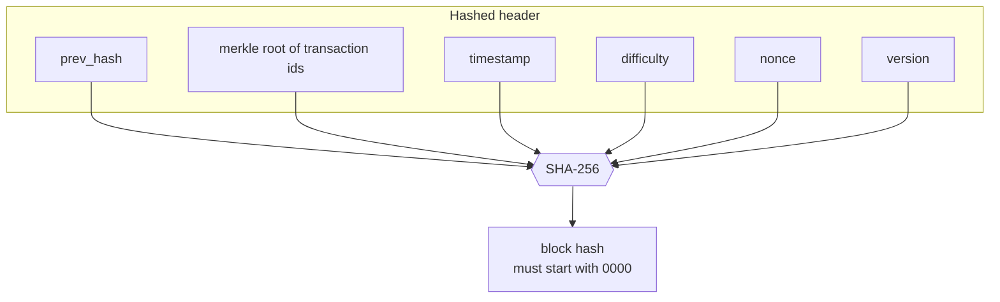

Transactions are folded into the root pairwise:

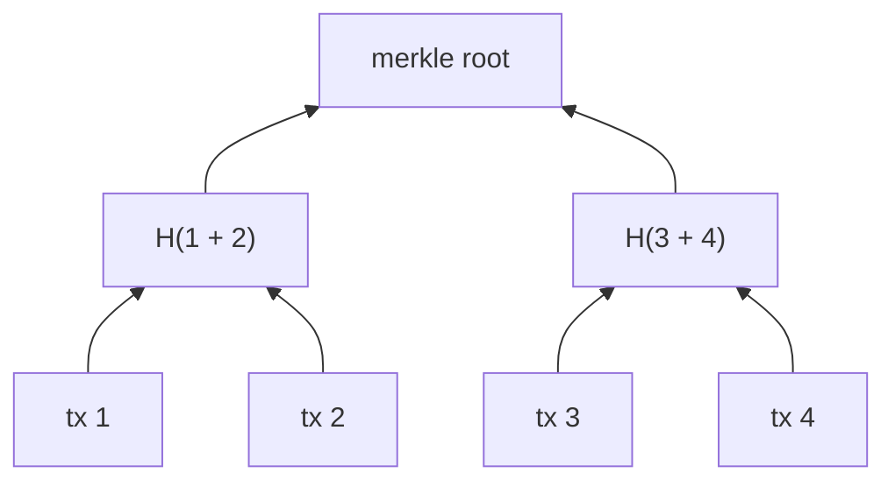

### Chain linking

Each block stores the hash of its parent, so changing any old block changes
every hash after it

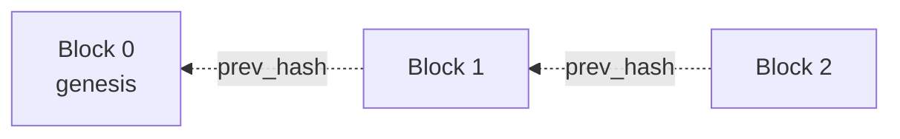

### Proof of work

The merkle root does not depend on the nonce, so it is computed once; only the
header hash is recomputed per attempt

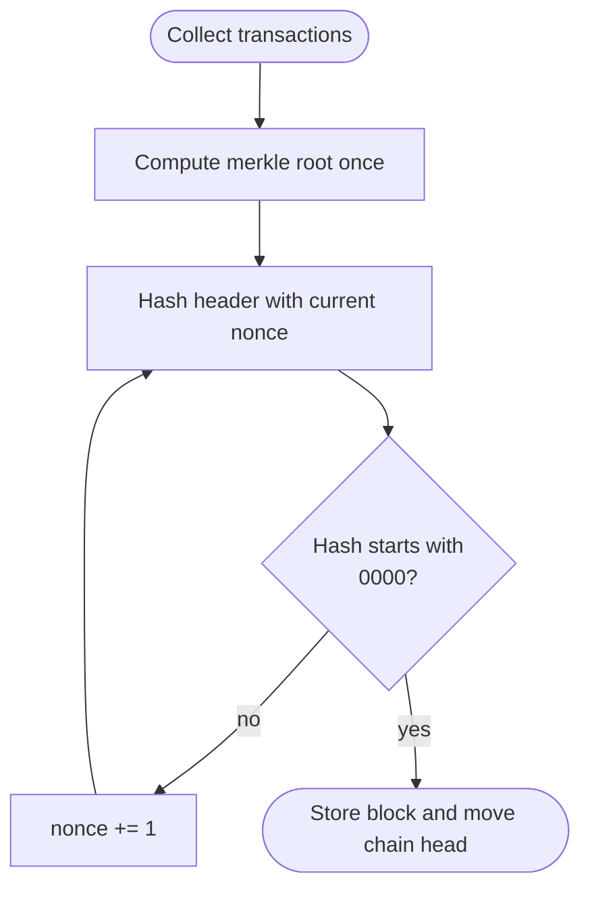

### Transactions and the UTXO model

Coins are never "in an account". A transaction destroys some previous outputs
and creates new ones; whatever is not sent comes back as a change output

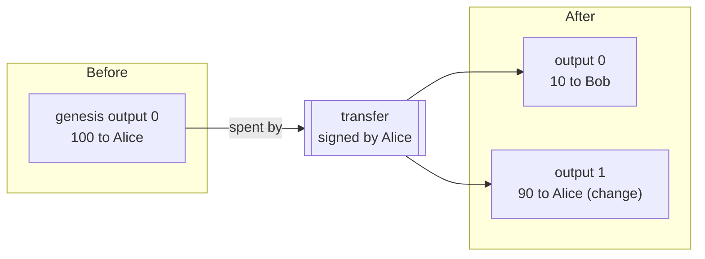

The UTXO index stores `txid -> [Option<TxOut>]`. A spent output becomes `None`
instead of being removed, so output indexes never shift

### Signing and verification

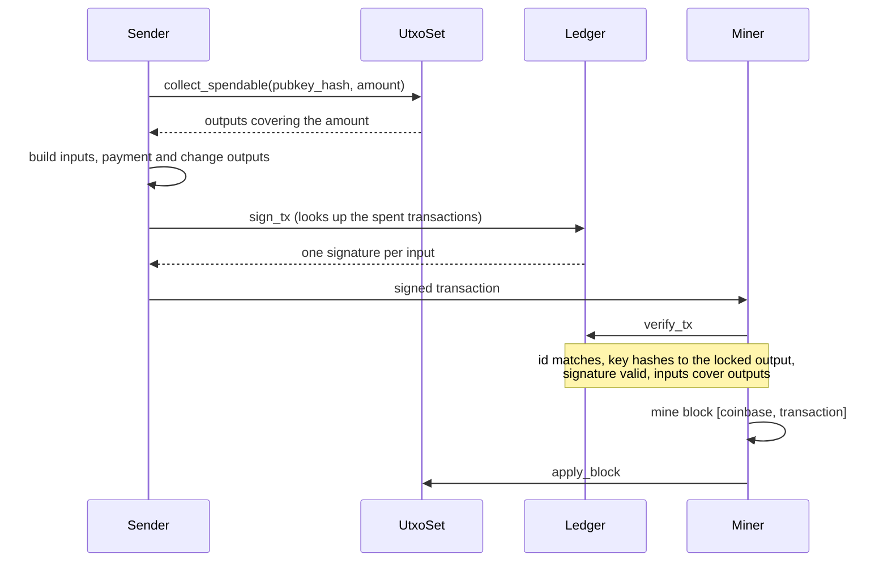

Each input signs a digest of the whole transaction in which every other input
is blanked and the signed input carries the hash of the output it spends, so a
signature cannot be replayed on a modified transaction

## Networking

Nodes speak a very small protocol over TCP: one connection carries one
bincode-encoded `Message`, and the sender closing the socket ends the frame

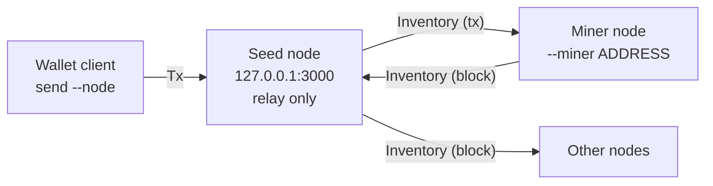

### Joining and syncing

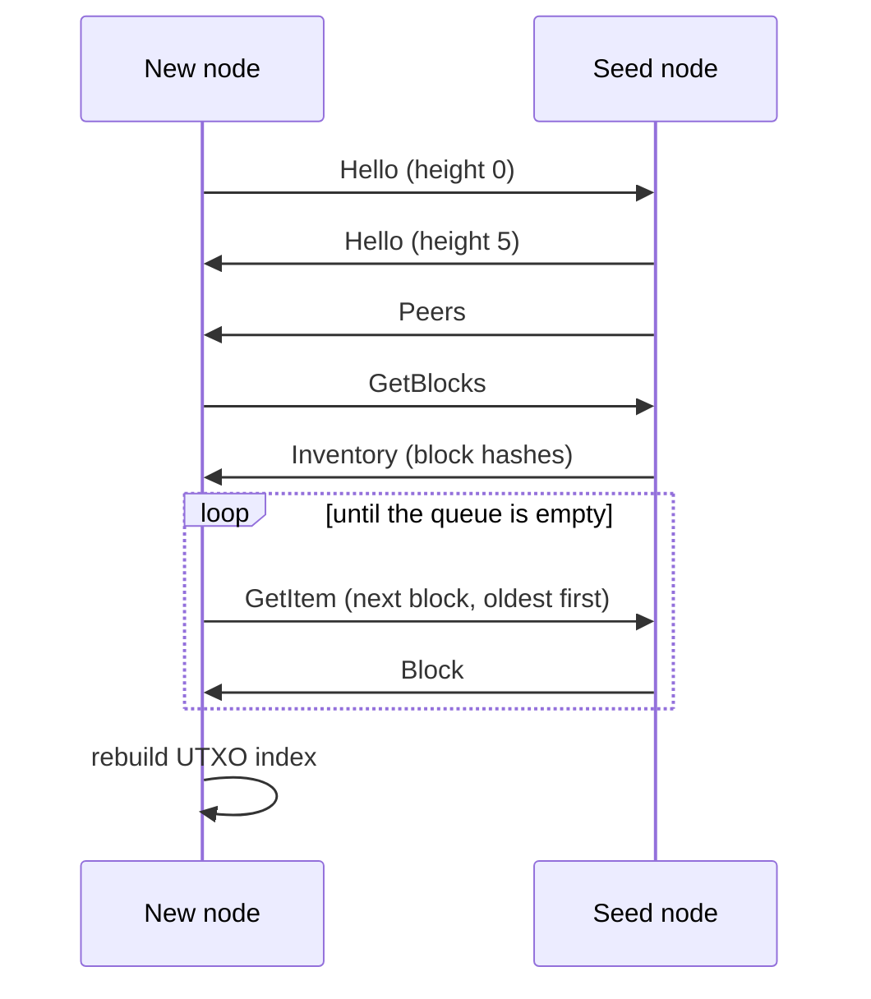

| Message | Purpose |
| --- | --- |
| `Hello` | Handshake with protocol version and chain height |
| `Peers` | Addresses of other known nodes |
| `Inventory` | Announces block hashes or transaction ids |
| `GetItem` | Requests one block or transaction by id |
| `GetBlocks` | Requests the full list of block hashes |
| `Block` | Carries a full block |
| `Tx` | Carries a full transaction |

Details and the exact flows are in [docs/protocol.md](docs/protocol.md)

### Running a local three-node demo

All nodes need the same genesis block, so create the chain once and copy the
data directory before starting anything:

```bash
minichain wallet create                       # note the address as ADDRESS_A
minichain wallet create                       # ADDRESS_B
minichain chain init <ADDRESS_A>
cp -r data data-miner                         # same genesis for the second node

# terminal 1 - seed node (relay only)
RUST_LOG=info minichain node start 3000

# terminal 2 - miner node
MINICHAIN_DATA=data-miner RUST_LOG=info \
  minichain node start 3001 --miner <ADDRESS_B>

# terminal 3 - wallet client
minichain send <ADDRESS_A> <ADDRESS_B> 10 --node 127.0.0.1:3000
```

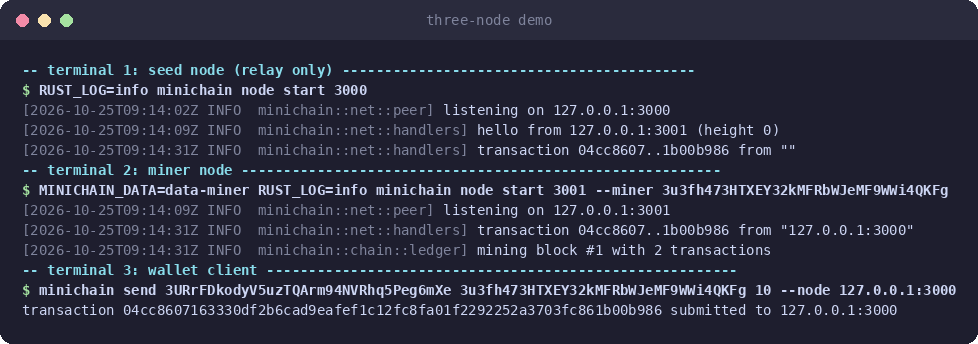

## Command reference

| Command | Description |
| --- | --- |
| `wallet create` | Generate a key pair and print its address |
| `wallet list` | List addresses in the local keystore |
| `chain init <ADDRESS>` | Create a new chain; genesis reward goes to `ADDRESS` (replaces any existing chain) |
| `chain show` | Print all blocks, newest first |
| `balance <ADDRESS>` | Show the balance of an address |
| `send <FROM> <TO> <AMOUNT>` | Pay locally and mine a block immediately |
| `send <FROM> <TO> <AMOUNT> --node HOST:PORT` | Submit the signed transaction to a running node |
| `utxo rebuild` | Recompute the unspent-output index from the chain |
| `node start <PORT> [--miner ADDRESS]` | Run a node on `127.0.0.1:PORT` |

See [docs/cli.md](docs/cli.md) for argument details and examples.

## Project layout

```text
.
├── Cargo.toml
├── src
│   ├── main.rs            entry point
│   ├── config.rs          constants and environment lookups
│   ├── crypto.rs          SHA-256, hash160, ed25519 helpers
│   ├── error.rs           shared Result / Error types
│   ├── store.rs           sled database and its trees
│   ├── wallet/            Keypair, address encoding, Keystore
│   ├── chain/
│   │   ├── tx.rs          TxIn / TxOut
│   │   ├── transaction.rs build, sign, verify
│   │   ├── merkle.rs      merkle root over transaction ids
│   │   ├── block.rs       block structure and proof-of-work
│   │   ├── ledger.rs      block store, head, chain iterator
│   │   └── utxo.rs        unspent output index
│   ├── net/
│   │   ├── message.rs     wire messages
│   │   ├── peer.rs        node state, accept loop, senders
│   │   └── handlers.rs    inbound handlers and mining trigger
│   └── cli/               argument parsing and chain rendering
├── docs/                  architecture, protocol, CLI, roadmap
├── scripts/               formatting helper, screenshot renderer
└── .github/workflows/     CI and stale-issue automation
```

## Configuration

| Setting | Where | Default |
| --- | --- | --- |
| Data directory | `MINICHAIN_DATA` environment variable | `data` |
| Log level | `RUST_LOG` (for example `info`, `debug`) | off |
| Proof-of-work difficulty | `POW_DIFFICULTY` in `src/config.rs` | `4` leading zero hex digits |
| Block reward | `BLOCK_REWARD` in `src/config.rs` | `100` |
| Seed node | `SEED_NODE` in `src/config.rs` | `127.0.0.1:3000` |

## Testing

```bash
cargo test
```

The suite covers hashing and signatures, address round trips, the keystore,
block mining and tamper detection, message encoding, and end-to-end ledger
scenarios (payments, change, overspending, forged and tampered transactions,
index rebuilds). `scripts/format.sh` runs `rustfmt` and `clippy`

## Further reading

- [Bitcoin Developer Reference - P2P network](https://developer.bitcoin.org/reference/p2p_networking.html)
- [Mastering Bitcoin](https://github.com/bitcoinbook/bitcoinbook)
- [Bitcoin Wiki](https://wiki.bitcoinsv.io)
- [Awesome Blockchain Rust](https://github.com/rust-in-blockchain/awesome-blockchain-rust)
- [Complete binary merkle trees explained](https://medium.com/coinmonks/merkle-tree-a-simple-explanation-and-implementation-48903442bc08)
